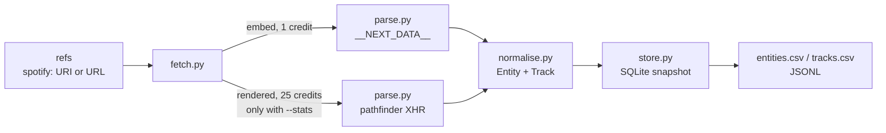

# Spotify API

<p align="center">
  <a href="https://www.scrapingbee.com/">
    
  </a>
</p>


[](https://github.com/ScrapingBee/spotify-api/actions)
[](LICENSE)

A four stage metadata pipeline for public open.spotify.com pages, built on the [Spotify API](https://www.scrapingbee.com/scrapers/spotify-api/) from ScrapingBee. Point it at artist, album, track and playlist links; it stores names, track lists, durations, release dates, follower and monthly listener counts, play counts and playlist save counts in SQLite, one snapshot per day, and exports CSV or JSONL.

It reads metadata and nothing else. No audio, no 30 second previews, no login, no account data. Every request goes through [ScrapingBee's HTML API](https://www.scrapingbee.com/documentation/) and every number in this README was measured against open.spotify.com on 2026-10-29.

## Two Spotify sites behind one domain

The first fetch of `open.spotify.com/artist/06HL4z0CvFAxyc27GXpf02` came back as 167 KB of nothing useful. The `<title>` read `Spotify - Web Player` (the page uses an en dash, swapped for a hyphen here), there was no JSON-LD, no artist name, and the body held three `<div>` elements before a run of base64 config blobs:

```html
<script id="appServerConfig" type="text/plain">eyJhcHBOYW1lIjoid2ViX3BsYXllcl9wcm90b3R5cGUiLCJtYXJrZXQiOiJU...
<script id="featureFlags" type="text/plain">eyJlbmFibGVTaG93cyI6dHJ1ZSwiZW5hYmxlQXVkaW9ib29rcyI6ZmFsc2Us...
```

`mode=auto` billed 1 credit for that and called it a success, because the status was 200. That is the trap with a single page app: the status code says nothing about whether data arrived.

The embed route is a different application. `open.spotify.com/embed/<kind>/<id>` is a Next.js page (the response carried `x-powered-by: Next.js`), and it ships its state in the HTML:

```html
<script id="__NEXT_DATA__" type="application/json">{"props":{"pageProps":{"state":{"data":{"entity":{"type":"album","name":"The Life of a Showgirl: The Encore","uri":"spot...
```

Trimmed to one row, the entity looks like this:

```json
{
  "type": "album",
  "name": "The Life of a Showgirl: The Encore",
  "uri": "spotify:album:4hF2gTGuPYlykYuphDxi8J",
  "id": "4hF2gTGuPYlykYuphDxi8J",
  "subtitle": "Taylor Swift",
  "releaseDate": { "isoString": "2026-09-25T04:00:00Z" },
  "isExplicit": false,
  "trackList": [
    {
      "uri": "spotify:track:0Gms8M0f1kJxAA2pXuLdtI",
      "title": "The Fate of Ophelia",
      "subtitle": "Taylor Swift",
      "isExplicit": false,
      "duration": 226073,
      "playabilityReason": "PLAYABLE",
      "audioPreview": { "format": "MP3_96", "url": "https://p.scdn.co/mp3-preview/f64d..." },
      "entityType": "track"
    }
  ]
}
```

That is the backbone of the pipeline: 1 credit per artist, album, track or playlist, no browser.

The embed does not show everything. Monthly listeners, world rank, top cities, play counts and playlist save counts only exist in the full web player, which builds them from GraphQL calls after load. Getting those meant a real browser on a premium proxy, and `json_response=true` to catch the XHR bodies.

## Measured cost per request

From the `spb-cost` header on each call:

| Request against open.spotify.com | Credits | What came back |
|---|---|---|
| `/artist/<id>`, `mode=auto` | 1 | Player shell, no artist data |
| `/artist/<id>`, `premium_proxy`, no JS | 10 | Same shell |
| `/artist/<id>`, `render_js` on a classic proxy | 5 | Rendered, still no artist name or stats in the DOM |
| `/artist/<id>`, `premium_proxy` + `render_js` + `json_response` | 25 | Full page, `102,061,916 monthly listeners`, pathfinder XHR bodies |
| `/embed/<kind>/<id>`, default (`render_js` on) | 5 | `__NEXT_DATA__` present |
| `/embed/<kind>/<id>`, `render_js=false` | 1 | Same `__NEXT_DATA__`, 10 KB to 154 KB |

So the pipeline defaults to 1 credit per reference and only spends 25 when you pass `--stats`. For a list of 500 albums that is 500 credits; for 50 artists with stats it is 1,300.

## Pipeline



The code is in [`examples/`](examples). Each stage is one file with no imports from later stages, so you can swap the store for Postgres or the fetcher for a queue worker without touching the parsers.

### Stage 1: fetch ([`fetch.py`](examples/fetch.py))

References come in as URIs or URLs, including `/intl-xx/` and `/embed/` forms:

```python
URI_RE = re.compile(r"spotify:(artist|album|track|playlist):([A-Za-z0-9]{22})")
URL_RE = re.compile(r"open\.spotify\.com/(?:intl-[a-z]{2}/)?(?:embed/)?(artist|album|track|playlist)/([A-Za-z0-9]{22})")
```

Both fetchers share one retry loop. ScrapingBee returns HTTP 500 when the target times out or refuses, and those calls are free, so retrying them costs nothing:

```python
def _call(self, params):
    last = None
    for attempt in range(self.retries):
        r = self.session.get(API, params=params, timeout=self.timeout)
        if r.status_code != 500:
            break
        last = r
        time.sleep(2 * (attempt + 1))
    else:
        r = last
    cost = int(r.headers.get("spb-cost", 0) or 0)
    self.credits_spent += cost
    r.raise_for_status()
    return r, cost

def fetch_embed(self, kind, spotify_id):
    r, cost = self._call({
        "url": f"https://open.spotify.com/embed/{kind}/{spotify_id}",
        "render_js": "false",
    })
    return RawPage(kind, spotify_id, "embed", r.status_code, cost, body=r.text)

def fetch_rendered(self, kind, spotify_id, wait_ms=8000):
    r, cost = self._call({
        "url": f"https://open.spotify.com/{kind}/{spotify_id}",
        "premium_proxy": "true",
        "render_js": "true",
        "block_resources": "false",
        "wait": str(wait_ms),
        "json_response": "true",
    })
    data = r.json()
    return RawPage(kind, spotify_id, "rendered", r.status_code, cost,
                   body=data.get("body", ""), xhr=data.get("xhr", []))
```

`block_resources=false` and the 8 second `wait` are there because the player fetches a token first and only then fires its GraphQL queries. Cut either and the XHR list comes back without the data calls.

Run it on its own to check a reference before a batch:

```
$ python fetch.py spotify:track:11hcBLPtbMp4aQI6zGQLub
{"kind": "track", "id": "11hcBLPtbMp4aQI6zGQLub", "status": 200, "credits": 1, "bytes": 10482, "has_next_data": true}
```

### Stage 2: parse ([`parse.py`](examples/parse.py))

Embed pages: one regex and a key path.

```python
NEXT_DATA_RE = re.compile(r'<script id="__NEXT_DATA__"[^>]*>(.*?)</script>', re.S)

def embed_entity(html):
    state = next_data(html)["props"]["pageProps"]["state"]
    entity = state.get("data", {}).get("entity")
    if not entity:
        raise ParseError("embed page has no data.entity")
    return entity
```

`state` also contains `settings.session.accessToken`, an anonymous token with `"isAnonymous": true`. The parser never touches it. Reading what the page displays is one thing; replaying a borrowed token against Spotify's private endpoints is another, and this repo does not do it.

Rendered pages: the browser's XHR list. On the artist page the useful one was a POST to `api-partner.spotify.com/pathfinder/v2/query` whose request body read:

```json
{"variables":{"uri":"spotify:artist:06HL4z0CvFAxyc27GXpf02","locale":"","preReleaseV2":false},"operationName":"queryArtistOverview","extensions":{"persistedQuery":{"version":1,"sha256Hash":"9f8134ef..."}}}
```

So the parser matches on `operationName` from `post_data`, never on list position:

```python
def pathfinder_ops(xhr):
    for rec in xhr:
        if "api-partner.spotify.com/pathfinder" not in rec.get("url", ""):
            continue
        try:
            req = json.loads(rec.get("post_data") or "{}")
            body = json.loads(rec.get("body") or "{}")
        except json.JSONDecodeError:
            continue
        if "data" in body:
            yield req.get("operationName"), req.get("variables", {}), body["data"]
```

The artist response, `data.artistUnion.stats`, trimmed:

```json
{
  "followers": 165980697,
  "monthlyListeners": 102061916,
  "topCities": {"items": [
    {"city": "London", "country": "GB", "numberOfListeners": 1573800, "region": "ENG"},
    {"city": "Quezon City", "country": "PH", "numberOfListeners": 1405680, "region": "00"}
  ]},
  "worldRank": 5
}
```

and the rendered DOM agrees with it:

```html
<span aria-hidden="true">102.1M monthly listeners</span><span class="e-101040-visually-hidden" data-encore-id="visuallyHidden">102,061,916 monthly listeners</span>
```

On a playlist page the player sent `fetchPlaylist` (offset 0, limit 25) and then `fetchPlaylistContents` (offset 25, limit 50), plus a `playlistPermissions` call that is not useful here.

### Stage 3: normalise ([`normalise.py`](examples/normalise.py))

Two dataclasses, `Entity` and `Track`, fed from either source. Durations become seconds, release dates become `YYYY-MM-DD`, the widest image wins, and `audioPreview` is dropped:

```python
def from_embed(entity):
    kind = entity["type"]
    sid = entity["id"]
    if kind == "track":
        artists = ", ".join(a["name"] for a in entity.get("artists", []))
        track = Track(sid, entity["name"], artists, round(entity["duration"] / 1000, 1),
                      bool(entity.get("isExplicit")), 1, sid)
        rows = [track]
    else:
        rows = [
            Track(_sid(t["uri"]), t["title"], t.get("subtitle", ""), round(t["duration"] / 1000, 1),
                  bool(t.get("isExplicit")), i, sid)
            for i, t in enumerate(entity.get("trackList", []), 1)
        ]
    ...
    maybe_truncated=kind in ("playlist", "album") and len(rows) >= EMBED_TRACK_CAP,
```

`maybe_truncated` matters. The embed for All Out 80s (`37i9dQZF1DX4UtSsGT1Sbe`) listed exactly 100 tracks. The full player reported `"totalCount": 150` for the same playlist. A playlist that comes back from the embed with 100 rows should be read as "at least 100", and the record says so until a `--stats` fetch confirms the real total.

The pathfinder tracks carry more than the embed rows. Each playlist row has a play count and, under `playlistAudioAttributes`, the tempo and key the player shows:

```json
"playcount": "1100027567",
"playlistAudioAttributes": {"bpm": 118.4749984741211, "key": {"camelotKey": {"color": "#56eff2", "value": "12A"}}}
```

`playlist_stats()` reads those, but only for the 75 rows the player loaded before it stopped and waited for a scroll. The pipeline keeps the embed's 100 rows and copies play count, BPM and key onto the rows where position and track id both match.

### Stage 4: store ([`store.py`](examples/store.py))

SQLite from the standard library, primary key `(spotify_id, snapshot)`, so a daily cron run builds a time series and a same day rerun overwrites:

```sql
CREATE TABLE IF NOT EXISTS entities (
    spotify_id TEXT, snapshot TEXT, kind TEXT, name TEXT, subtitle TEXT,
    release_date TEXT, image TEXT, track_count_seen INTEGER,
    track_count_total INTEGER, maybe_truncated INTEGER, followers INTEGER,
    monthly_listeners INTEGER, world_rank INTEGER, top_cities TEXT,
    description TEXT,
    PRIMARY KEY (spotify_id, snapshot)
);
```

`Store.history(id, "monthly_listeners")` returns the series for one artist, which is the query A&R and playlist research work starts from.

## Running the Spotify scraper end to end

[`pipeline.py`](examples/pipeline.py) is the CLI that wires the stages together.

```bash
export SCRAPINGBEE_API_KEY=...
pip install requests

# 1 credit each, embed only
python examples/pipeline.py spotify:album:4hF2gTGuPYlykYuphDxi8J \
    https://open.spotify.com/track/11hcBLPtbMp4aQI6zGQLub \
    spotify:playlist:37i9dQZF1DX0D996ZXujBy \
    --db embed.db --csv-dir out_embed
```

```
album    The Life of a Showgirl: The Encore: 16 tracks
track    Patient Zero: 1 tracks
playlist Taylor Swift | The Eras Tour Official Setlist: 44 tracks
wrote out_embed/entities.csv
wrote out_embed/tracks.csv
{"credits": 3}
```

With `--stats` on an artist and a long playlist:

```bash
python examples/pipeline.py spotify:artist:06HL4z0CvFAxyc27GXpf02 \
    https://open.spotify.com/playlist/37i9dQZF1DX4UtSsGT1Sbe \
    --stats --db stats.db --csv-dir out_stats --jsonl-dir out_stats
```

```
artist   Taylor Swift: 10 tracks, 102,061,916 monthly listeners, rank 5
playlist All Out 80s: 100/150 tracks, 12,059,999 saves (list may be cut short)
wrote out_stats/entities.csv
wrote out_stats/tracks.csv
wrote out_stats/entities.jsonl
wrote out_stats/tracks.jsonl
{"credits": 52}
```

The save count read 12,059,988 in the first capture of the morning and 12,059,999 in this run, which is why snapshots carry a date.

First rows of `tracks.csv` for the artist, from `queryArtistOverview`:

```
parent_id,snapshot,position,track_id,name,artists,duration_s,explicit,playcount,bpm,camelot_key
06HL4z0CvFAxyc27GXpf02,2026-10-29,1,11hcBLPtbMp4aQI6zGQLub,Patient Zero,Taylor Swift,225.9,0,126322091,,
06HL4z0CvFAxyc27GXpf02,2026-10-29,2,53iuhJlwXhSER5J2IYYv1W,The Fate of Ophelia,Taylor Swift,226.1,0,1756948962,,
```

And the playlist rows in SQLite, at the edges of what each source covered:

```
$ sqlite3 stats.db "select position,name,artists,playcount,bpm,camelot_key from tracks
    where parent_id='37i9dQZF1DX4UtSsGT1Sbe' and position in (1,2,75,76,100)"
1|Thriller|Michael Jackson|1100027567|118.5|12A
2|Take on Me|a-ha|2978250459|84.4|11B
75|With Or Without You|U2|1548618352|110.2|10B
76|Sacrifice|Elton John|||
100|You Can't Hurry Love - 2016 Remaster|Phil Collins|||
```

Rows 76 to 100 came from the embed only, and rows 101 to 150 exist on Spotify but in neither capture. Getting them would mean a `js_scenario` that scrolls the track list and another 25 credit render; it is not wired in here.

### Node.js

[`embed_tracklist.js`](examples/embed_tracklist.js) is the embed route alone as a TSV dump, Node 18+ and no packages:

```
$ node examples/embed_tracklist.js spotify:playlist:37i9dQZF1DX0D996ZXujBy
playlist "Taylor Swift | The Eras Tour Official Setlist" by Spotify: 44 rows, 1 credit(s)
pos	track_id	title	artists	length	explicit
1	214nt20w5wOxJnY462klLw	Miss Americana & The Heartbreak Prince	Taylor Swift	3:54
2	1BxfuPKGuaTgP7aM0Bbdwr	Cruel Summer	Taylor Swift	2:58
3	3RauEVgRgj1IuWdJ9fDs70	The Man	Taylor Swift	3:10
```

## Spotify Web API or the public pages

Spotify has an official [Web API](https://developer.spotify.com/documentation/web-api). What its own documentation says, checked on 2026-10-29:

- You register an app in the developer dashboard to get a Client ID and Client Secret, and calls are authorised with OAuth 2.0. The [Client Credentials flow](https://developer.spotify.com/documentation/web-api/tutorials/client-credentials-flow) covers server to server calls that do not touch user data.
- A new app starts in development mode, with limits on how many users can install it and how many requests it can make, and a quota extension is something you request.
- Since the [27 November 2024 change](https://developer.spotify.com/blog/2024-11-27-changes-to-the-web-api), apps in development mode and apps registered from that date can no longer use Related Artists, Recommendations, Audio Features or the 30 second preview URLs.
- The [Get Artist](https://developer.spotify.com/documentation/web-api/reference/get-an-artist) response marks `followers`, `genres` and `popularity` as deprecated, and it has no monthly listener field.

If your job is reading or writing a user's library, or anything a user grants your app, use the Web API; that is what it is built for and scraping cannot touch it. Public page scraping fits the other cases: you need monthly listeners, world rank, top cities or per track play counts, which the player shows and the API response does not; you want playlist tempo and key data that new apps can no longer get from Audio Features; or you are tracking public numbers across thousands of artists and do not want to manage an app, a client secret and a quota.

Whatever the route, Spotify's API documentation asks that metadata, cover art and artist images be shown with a link back to the item on Spotify, and that content not be downloaded. Both are reasonable rules to keep when the data came from a page instead.

## Scope and limits

- **Logged out only.** Your library, private playlists, listening history and anything behind a Spotify login are out of scope. ScrapingBee's terms prohibit scraping behind a login, and this code never sends credentials or cookies.
- **No audio.** The embed rows contain `p.scdn.co/mp3-preview/...` URLs. The normaliser drops them and nothing in this repo requests them.
- **Embed lists stop at 100.** Treat a 100 row playlist as possibly longer until a `--stats` run says otherwise.
- **The rendered player loads 75 playlist rows** before it waits for a scroll, so play counts, BPM and key cover at most the first 75.
- **Artist embeds are top tracks,** 10 rows, not a discography. The discography sits in `queryArtistOverview` under `discography.albums` (`totalCount` 34 for this artist) and `discography.singles` (80); the pipeline does not store them yet.
- **Stats drift during the day.** Store a date with every number.

## Related ScrapingBee pages

Docs: [data extraction rules](https://www.scrapingbee.com/documentation/data-extraction/), [JavaScript scenario](https://www.scrapingbee.com/documentation/js-scenario/), [`json_response` and XHR capture](https://www.scrapingbee.com/documentation/#json_response), [premium proxies](https://www.scrapingbee.com/documentation/#premium_proxy), [pricing and the 1,000 free credits](https://www.scrapingbee.com/pricing/).

Other music and media scrapers: [Apple Music API](https://www.scrapingbee.com/scrapers/apple-music-api/), [SoundCloud API](https://www.scrapingbee.com/scrapers/soundcloud-api/), [YouTube Music API](https://www.scrapingbee.com/scrapers/youtube-music-api/), [music metadata API](https://www.scrapingbee.com/scrapers/music-metadata-api/), [Twitch API](https://www.scrapingbee.com/scrapers/twitch-api/), [TikTok API](https://www.scrapingbee.com/scrapers/tiktok-api/).

## FAQ

**Is there a free Spotify API?**
Spotify's official Web API needs a registered app and OAuth credentials, and a development mode app runs under user and request limits until Spotify grants a quota extension. This repo takes the other road: public pages through ScrapingBee, 1 credit per embed fetch, with 1,000 free credits on signup.

**How do I get monthly listeners for a Spotify artist?**
From the rendered artist page. `queryArtistOverview` returns `stats.monthlyListeners`, and the DOM shows the same figure in a visually hidden span. The Web API's artist object has no such field. Expect 25 credits per artist, since only a premium proxy with JavaScript rendering filled the page.

**Why does my Spotify scraper return an empty page?**
Because `open.spotify.com/<kind>/<id>` sends a player shell without a browser, with status 200. Check for data, not for the status code. Switch to `/embed/<kind>/<id>`, which carries `__NEXT_DATA__` for 1 credit.

**Can I scrape a whole Spotify playlist?**
Up to 100 tracks from the embed. For longer ones the player reports the real `totalCount` (150 for All Out 80s), and reaching the rest needs a scrolling `js_scenario` that is not in this pipeline.

**Does this download songs or previews?**
No. The preview URL is visible in the embed JSON and the code discards it.

## License

MIT. See [LICENSE](LICENSE).
